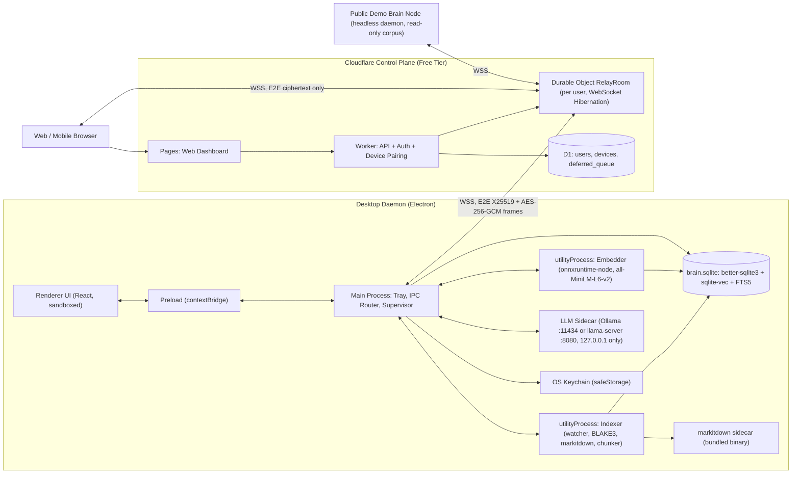
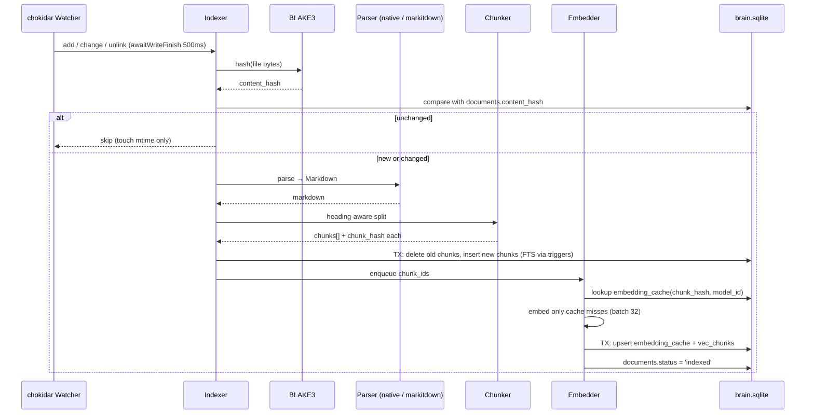
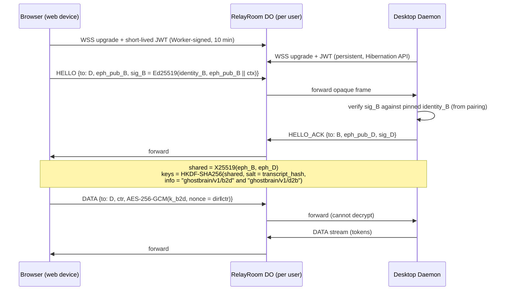

# 01 — GhostBrain Main Core & Cloud Relay

> **Project ID:** `P1-CORE` · **Status:** Phase 1 / Chapter 1 — ACTIVE · **Owner Lens:** Deep R&D
> **Depends on:** none · **Consumed by:** `P2-LICENSE` (feature gates), `P3-CLINIC` (LAN host mode), `P4-TUNING` (model slot)

---

## 0. Scope & Hard Boundaries

| In Scope (P1)                                                   | Out of Scope (owned elsewhere)                |
| :-------------------------------------------------------------- | :-------------------------------------------- |
| Electron desktop daemon, tray, IPC                              | License issuance / billing webhooks → `P2` |
| Folder watcher, BLAKE3 hashing, markdown chunker                | SQLCipher, RBAC, audit log, Air-Gap → `P3` |
| `sqlite-vec` + `FTS5` hybrid RRF search                     | Custom model fine-tuning → `P4`            |
| Local LLM sidecar (Ollama / `llama-server`) + ONNX embeddings | Legal templates, signing certs → `05`      |
| Cloudflare Pages UI, Workers + Durable Objects relay, D1 queue  |                                               |
| Public Demo Brain node, cross-platform CI/CD + auto-update      |                                               |

**Integration contracts P1 must expose (stable interfaces, no implementation of other projects):**

- `LicenseGate.can(feature): boolean` — stubbed to `true` in P1; implemented by P2.
- `StorageDriver` — opens the DB via `better-sqlite3-multiple-ciphers` from day one so P3 can enable SQLCipher without a driver swap.
- `SearchScope { allowedFolderIds?: number[] }` — accepted by the search API in P1 (ignored when undefined); enforced by P3 RBAC.
- `ModelProvider` — sidecar abstraction; P4 drops in a custom GGUF without touching call sites.

---

## 1. System Architecture




**Zero-knowledge invariant:** Cloudflare never receives plaintext documents, queries, answers, or private keys. The relay routes opaque ciphertext frames by `device_id`.

---

## 2. Process Model & Responsibilities

| Process               | Runtime                                                                             | Responsibilities                                                                            | Crash Policy                                                                                                |
| :-------------------- | :---------------------------------------------------------------------------------- | :------------------------------------------------------------------------------------------ | :---------------------------------------------------------------------------------------------------------- |
| **Main**        | Electron main                                                                       | Tray, window lifecycle, IPC router, supervisor, relay client, DB writer for chat/settings   | Fatal → app restart                                                                                        |
| **Renderer**    | Chromium, `sandbox: true`, `contextIsolation: true`, `nodeIntegration: false` | UI only; zero Node access                                                                   | Reload window                                                                                               |
| **Indexer**     | `utilityProcess`                                                                  | `chokidar` watcher, BLAKE3 hashing, markitdown parse, chunking, DB writes for docs/chunks | Restart w/ exponential backoff (1s→60s)                                                                    |
| **Embedder**    | `utilityProcess`                                                                  | ONNX inference, mean-pool + L2-normalize, `embedding_cache` lookup                        | Restart w/ backoff; queue persists in DB                                                                    |
| **LLM Sidecar** | External binary                                                                     | Token streaming                                                                             | Health-check `/api/tags` or `/health` every 10s; OOM → restart with smaller `num_ctx` / CPU fallback |
| **markitdown**  | Bundled PyInstaller binary (MIT)                                                    | PDF/DOCX/PPTX/XLSX/HTML → Markdown                                                         | Per-file timeout (60s), mark `documents.status='error'`                                                   |

> [!NOTE]
> `markitdown` is a Python project. Ship it as a per-OS frozen binary built in CI (PyInstaller) and code-sign it alongside the app. Native `.md`/`.txt` files bypass it entirely.

---

## 3. Proposed Monorepo Layout (for Phase 1 scaffolding — not created this turn)

```text
GhostBrain/
├─ apps/
│  ├─ desktop/          # Electron main, preload, renderer (P1)
│  └─ web/              # Cloudflare Pages dashboard (P1)
├─ workers/
│  ├─ relay/            # Worker + RelayRoom Durable Object + D1 migrations (P1)
│  └─ license/          # MoR webhooks + Ed25519 issuer (P2)
├─ packages/
│  ├─ core/             # chunker, hashing, RRF, search API (pure TS, Vitest)
│  ├─ crypto/           # X25519/HKDF/AES-GCM framing, shared by desktop + web
│  ├─ licensing-client/ # offline Ed25519 verifier (P2)
│  └─ shared-types/     # IPC + wire protocol types
├─ sidecars/            # markitdown build scripts, llama-server pins
├─ docs/                # these specs
└─ .github/workflows/   # CI matrix (Phase 3)
```

---

## 4. Local Data Model — `brain.sqlite`

**Pragmas (on every open):** `journal_mode=WAL`, `synchronous=NORMAL`, `foreign_keys=ON`, `busy_timeout=5000`, `temp_store=MEMORY`.

```sql
-- ── Meta ────────────────────────────────────────────────────────────
CREATE TABLE schema_meta (
  key   TEXT PRIMARY KEY,           -- 'schema_version','embedding_model_id','embedding_dims'
  value TEXT NOT NULL
);

CREATE TABLE settings (
  key        TEXT PRIMARY KEY,
  value_json TEXT NOT NULL,
  updated_at INTEGER NOT NULL
);

-- ── Sources ─────────────────────────────────────────────────────────
CREATE TABLE watched_folders (
  id            INTEGER PRIMARY KEY,
  abs_path      TEXT NOT NULL UNIQUE,
  label         TEXT,
  include_globs TEXT NOT NULL DEFAULT '["**/*.{md,txt,pdf,docx,pptx,xlsx,html}"]',
  exclude_globs TEXT NOT NULL DEFAULT '["**/node_modules/**","**/.git/**"]',
  is_enabled    INTEGER NOT NULL DEFAULT 1 CHECK (is_enabled IN (0,1)),
  created_at    INTEGER NOT NULL
);

CREATE TABLE documents (
  id           INTEGER PRIMARY KEY,
  folder_id    INTEGER NOT NULL REFERENCES watched_folders(id) ON DELETE CASCADE,
  rel_path     TEXT NOT NULL,
  content_hash BLOB NOT NULL,                 -- BLAKE3-256 of raw file bytes (32 bytes)
  mime         TEXT,
  size_bytes   INTEGER NOT NULL,
  mtime_ms     INTEGER NOT NULL,
  parser       TEXT NOT NULL,                 -- 'native-md' | 'markitdown@<ver>'
  status       TEXT NOT NULL DEFAULT 'pending'
               CHECK (status IN ('pending','parsing','embedding','indexed','error','deleted')),
  error        TEXT,
  indexed_at   INTEGER,
  UNIQUE (folder_id, rel_path)
);
CREATE INDEX idx_documents_status ON documents(status);
CREATE INDEX idx_documents_hash   ON documents(content_hash);

-- ── Chunks (FTS5 + vec0 share chunks.id as rowid) ───────────────────
CREATE TABLE chunks (
  id           INTEGER PRIMARY KEY,
  document_id  INTEGER NOT NULL REFERENCES documents(id) ON DELETE CASCADE,
  folder_id    INTEGER NOT NULL,              -- denormalized for scoped search (P3 RBAC)
  ordinal      INTEGER NOT NULL,
  chunk_hash   BLOB NOT NULL,                 -- BLAKE3-256 of normalized chunk text
  heading_path TEXT,                          -- 'H1 > H2 > H3'
  text         TEXT NOT NULL,
  token_count  INTEGER NOT NULL,
  char_start   INTEGER NOT NULL,
  char_end     INTEGER NOT NULL,
  UNIQUE (document_id, ordinal)
);
CREATE INDEX idx_chunks_hash   ON chunks(chunk_hash);
CREATE INDEX idx_chunks_folder ON chunks(folder_id);

-- Content-addressable embedding cache: identical text is never embedded twice.
CREATE TABLE embedding_cache (
  chunk_hash BLOB NOT NULL,
  model_id   TEXT NOT NULL,                   -- e.g. 'all-MiniLM-L6-v2@onnx-int8'
  vector     BLOB NOT NULL,                   -- float32[384], little-endian
  created_at INTEGER NOT NULL,
  PRIMARY KEY (chunk_hash, model_id)
) WITHOUT ROWID;

-- ── Vectors (sqlite-vec) — created before triggers that reference it ─
CREATE VIRTUAL TABLE vec_chunks USING vec0(
  chunk_id  INTEGER PRIMARY KEY,
  folder_id INTEGER,                          -- metadata column → KNN pre-filter (P3)
  embedding float[384] distance_metric=cosine
);

-- ── Full-text (external content) ────────────────────────────────────
CREATE VIRTUAL TABLE fts_chunks USING fts5(
  text, heading_path,
  content='chunks', content_rowid='id',
  tokenize='porter unicode61 remove_diacritics 2'
);

CREATE TRIGGER chunks_ai AFTER INSERT ON chunks BEGIN
  INSERT INTO fts_chunks(rowid, text, heading_path) VALUES (new.id, new.text, new.heading_path);
END;
CREATE TRIGGER chunks_ad AFTER DELETE ON chunks BEGIN
  INSERT INTO fts_chunks(fts_chunks, rowid, text, heading_path)
    VALUES ('delete', old.id, old.text, old.heading_path);
  DELETE FROM vec_chunks WHERE chunk_id = old.id;
END;
CREATE TRIGGER chunks_au AFTER UPDATE OF text, heading_path ON chunks BEGIN
  INSERT INTO fts_chunks(fts_chunks, rowid, text, heading_path)
    VALUES ('delete', old.id, old.text, old.heading_path);
  INSERT INTO fts_chunks(rowid, text, heading_path) VALUES (new.id, new.text, new.heading_path);
END;

-- ── Work queue (survives crashes) ───────────────────────────────────
CREATE TABLE index_jobs (
  id          INTEGER PRIMARY KEY,
  document_id INTEGER NOT NULL REFERENCES documents(id) ON DELETE CASCADE,
  stage       TEXT NOT NULL CHECK (stage IN ('parse','embed')),
  attempts    INTEGER NOT NULL DEFAULT 0,
  next_run_at INTEGER NOT NULL,
  last_error  TEXT,
  UNIQUE (document_id, stage)
);

-- ── Conversations ───────────────────────────────────────────────────
CREATE TABLE conversations (
  id         INTEGER PRIMARY KEY,
  title      TEXT,
  origin     TEXT NOT NULL DEFAULT 'local' CHECK (origin IN ('local','relay','demo','lan')),
  created_at INTEGER NOT NULL
);
CREATE TABLE messages (
  id              INTEGER PRIMARY KEY,
  conversation_id INTEGER NOT NULL REFERENCES conversations(id) ON DELETE CASCADE,
  role            TEXT NOT NULL CHECK (role IN ('user','assistant','system')),
  content         TEXT NOT NULL,
  citations_json  TEXT,                       -- [{chunk_id, document_id, rel_path, score}]
  model_id        TEXT,
  latency_ms      INTEGER,
  created_at      INTEGER NOT NULL
);
CREATE INDEX idx_messages_conv ON messages(conversation_id, created_at);
```

> [!IMPORTANT]
> **Embedding-model versioning:** `schema_meta.embedding_model_id` is checked on boot. A mismatch (e.g., P4 ships a tuned embedder) triggers a background re-embed driven by `embedding_cache` misses — no schema migration needed.

> [!WARNING]
> **Verify at implementation:** `vec0` metadata-column filtering supports `=`, `<`, `>` etc.; confirm `IN (...)` support in the pinned `sqlite-vec` version. Fallback: per-folder KNN fan-out merged via RRF.

---

## 5. Ingestion Pipeline



**Chunker spec (all-MiniLM-L6-v2 has a 256 word-piece max sequence length):**

- Split on Markdown headings first; keep `heading_path` breadcrumbs.
- Target **200 tokens**, hard cap **256**, overlap **32 tokens**; never split inside fenced code blocks or tables unless they exceed the cap.
- Normalize before hashing: NFC, collapse whitespace, strip trailing spaces → `chunk_hash = BLAKE3(normalized_text)`.
- Token counts use the model's own WordPiece tokenizer (shipped with the ONNX bundle).

---

## 6. Hybrid Search — Reciprocal Rank Fusion

`score(chunk) = Σ_{list ∈ {vec, fts}} 1 / (k + rank_list(chunk))`, default `k = 60`, `k_vec = k_fts = 40`, `top_n = 8`.

```sql
WITH
vec_hits AS (
  SELECT chunk_id, row_number() OVER (ORDER BY distance) AS rnk
  FROM vec_chunks
  WHERE embedding MATCH :qvec AND k = :k_vec
  -- P3: AND folder_id IN (...allowed)  (see §4 warning)
),
fts_hits AS (
  SELECT chunk_id, row_number() OVER (ORDER BY score) AS rnk
  FROM (
    SELECT rowid AS chunk_id, bm25(fts_chunks, 1.0, 0.4) AS score
    FROM fts_chunks
    WHERE fts_chunks MATCH :fts_query          -- sanitized: each term double-quoted
    ORDER BY score
    LIMIT :k_fts
  )
),
fused AS (
  SELECT chunk_id, SUM(1.0 / (:rrf_k + rnk)) AS rrf
  FROM (SELECT * FROM vec_hits UNION ALL SELECT * FROM fts_hits)
  GROUP BY chunk_id
)
SELECT c.id, c.text, c.heading_path, d.rel_path, f.rrf
FROM fused f
JOIN chunks c    ON c.id = f.chunk_id
JOIN documents d ON d.id = c.document_id
WHERE d.status = 'indexed'
ORDER BY f.rrf DESC
LIMIT :top_n;
```

**LLM prompt contract:** retrieved chunks are injected as numbered sources `[S1]…[Sn]`; the model must cite `[Sx]`; the app maps `Sx → chunk_id → rel_path` and renders clickable citations. Uncited answers are flagged in the UI. (P4 fine-tunes for this exact format.)

---

## 7. IPC Contract (Renderer ⇄ Main via `contextBridge`)

| Channel                         | Direction | Payload                                      | Notes                                                                                 |
| :------------------------------ | :-------- | :------------------------------------------- | :------------------------------------------------------------------------------------ |
| `folders:list / add / remove` | invoke    | `{absPath}`                                | `add` opens native picker in main; renderer never sends arbitrary paths unvalidated |
| `index:status`                | event     | `{pending, indexed, errors, etaSec}`       | throttled 2 Hz                                                                        |
| `search:query`                | invoke    | `{q, scope?}` → `Hit[]`                 |                                                                                       |
| `chat:ask`                    | invoke    | `{conversationId?, q}` → `{streamId}`   |                                                                                       |
| `chat:token`                  | event     | `{streamId, delta}`                        |                                                                                       |
| `chat:done`                   | event     | `{streamId, citations, latencyMs}`         |                                                                                       |
| `power:get / set`             | invoke    | `'performance' \| 'balanced' \| 'low-power'` | Ch 4                                                                                  |
| `relay:status`                | event     | `{connected, deviceId, peers}`             | Phase 2                                                                               |

**Security rules:** validate `event.senderFrame.url` on every handler, strict CSP (`default-src 'self'`), no `remote` module, `setWindowOpenHandler` denies by default, `will-navigate` blocked.

---

## 8. Cloud Control Plane

### 8.1 D1 Schema — `ghostbrain-control`

```sql
CREATE TABLE users (
  id             TEXT PRIMARY KEY,            -- uuid v7
  email          TEXT NOT NULL UNIQUE,
  oauth_provider TEXT NOT NULL,               -- 'google' | 'github'
  oauth_sub      TEXT NOT NULL,
  created_at     INTEGER NOT NULL,
  UNIQUE (oauth_provider, oauth_sub)
);

CREATE TABLE devices (
  id            TEXT PRIMARY KEY,
  user_id       TEXT NOT NULL REFERENCES users(id) ON DELETE CASCADE,
  kind          TEXT NOT NULL CHECK (kind IN ('desktop','web','demo')),
  name          TEXT NOT NULL,
  x25519_pub    BLOB NOT NULL,                -- 32 bytes, long-term identity (key agreement)
  ed25519_pub   BLOB NOT NULL,                -- 32 bytes, signs ephemeral keys
  fingerprint   TEXT NOT NULL,                -- base32(BLAKE3(ed25519_pub||x25519_pub))[0..20]
  last_seen_at  INTEGER,
  revoked_at    INTEGER,
  created_at    INTEGER NOT NULL
);
CREATE INDEX idx_devices_user ON devices(user_id);

-- RFC 8628 Device Authorization Grant
CREATE TABLE device_codes (
  device_code_hash TEXT PRIMARY KEY,          -- SHA-256 of device_code; raw never stored
  user_code        TEXT NOT NULL UNIQUE,      -- 'WDJB-MJHT'
  pending_pub_json TEXT NOT NULL,             -- device public keys awaiting approval
  user_id          TEXT REFERENCES users(id),
  status           TEXT NOT NULL CHECK (status IN ('pending','approved','denied','expired')),
  poll_interval_s  INTEGER NOT NULL DEFAULT 5,
  expires_at       INTEGER NOT NULL
);

CREATE TABLE refresh_tokens (
  token_hash  TEXT PRIMARY KEY,
  device_id   TEXT NOT NULL REFERENCES devices(id) ON DELETE CASCADE,
  expires_at  INTEGER NOT NULL,
  rotated_at  INTEGER
);

-- Offline Web Clipper + Deferred Query Queue (ciphertext only)
CREATE TABLE deferred_queue (
  id               TEXT PRIMARY KEY,
  user_id          TEXT NOT NULL REFERENCES users(id) ON DELETE CASCADE,
  sender_device_id TEXT NOT NULL REFERENCES devices(id),
  target_device_id TEXT NOT NULL REFERENCES devices(id),
  kind             TEXT NOT NULL CHECK (kind IN ('clip','query','answer')),
  ephemeral_pub    BLOB NOT NULL,             -- sealed-box style: per-item X25519 ephemeral
  nonce            BLOB NOT NULL,             -- 12 bytes
  ciphertext       BLOB NOT NULL,             -- AES-256-GCM(payload) — cap 512 KB
  size_bytes       INTEGER NOT NULL,
  created_at       INTEGER NOT NULL,
  expires_at       INTEGER NOT NULL,          -- default +30 days
  delivered_at     INTEGER
);
CREATE INDEX idx_queue_target ON deferred_queue(target_device_id, delivered_at);
CREATE INDEX idx_queue_expiry ON deferred_queue(expires_at);
```

> [!NOTE]
> D1 rows are capped (~2 MB). Clips are capped at 512 KB ciphertext; larger clips would move to R2 (also ciphertext-only) in a later iteration.

### 8.2 E2E Relay Handshake



**Crypto rules:**

- Nonce = 4-byte direction tag ‖ 8-byte monotonic counter → never reused; receiver rejects `ctr ≤ last_ctr` (replay protection).
- Re-key after 2²⁰ frames or 24 h.
- Identity keys pinned at pairing; desktop shows a fingerprint/QR that the browser user confirms → the relay cannot MITM by substituting keys.
- Desktop private keys stored via Electron `safeStorage` (OS keychain-backed). Browser keys stored as non-extractable `CryptoKey` in IndexedDB where WebCrypto X25519 is supported; audited `@noble/curves` fallback otherwise.
- Library choice: `@noble/curves` + `@noble/hashes` (audited, pure JS) in `packages/crypto` for identical behavior across Node, Workers, and browsers.

### 8.3 Free-Tier Budget (verify current limits before Phase 2)

| Service         | Free Allowance (approx.)                                              | GhostBrain Usage Strategy                  |
| :-------------- | :-------------------------------------------------------------------- | :----------------------------------------- |
| Workers         | 100k requests/day, 10 ms CPU/invocation                               | Auth + pairing only; no crypto on hot path |
| Durable Objects | Available on Free plan (SQLite-backed), daily request + duration caps | WebSocket Hibernation API; one DO per user |
| D1              | 5 GB storage, ~5M rows read / 100k rows written per day               | Queue TTL purge via Cron Trigger daily     |
| Pages           | Unlimited static bandwidth, 500 builds/month                          | Static SPA build                           |

---

## 9. Phases → Chapters → Target Goals → Actionable Steps

### PHASE 1 — Local Hybrid RAG Engine

#### Chapter 1.1 — Electron Main/Renderer IPC & Tray Daemon  `◀ ACTIVE`

**Target Goal:** A signed-off Electron shell that launches to tray, survives window close, and exposes a typed, secure IPC bridge.

- [ ] Scaffold monorepo (`pnpm` workspaces) with `apps/desktop`, `packages/core`, `packages/shared-types`.
- [ ] Electron + Vite (`electron-vite`) with TypeScript strict mode.
- [ ] `BrowserWindow` hardening: `sandbox`, `contextIsolation`, no `nodeIntegration`, CSP, navigation guards.
- [ ] Preload `contextBridge` API generated from `shared-types` IPC map (typed invoke/on).
- [ ] Tray icon + menu (Open, Pause Indexing, Power Mode, Quit); close-to-tray; single-instance lock.
- [ ] Auto-launch at login (opt-in) via `app.setLoginItemSettings`.
- [ ] Supervisor skeleton for `utilityProcess` children with backoff restart.
- [ ] Open DB via `better-sqlite3-multiple-ciphers`, load `sqlite-vec`, run migration v1 (§4).
- [ ] `electron-rebuild` / prebuilds verified on Windows dev machine.

- **Exit criteria:** cold start < 2 s to tray; IPC round-trip < 5 ms; renderer has zero Node globals (asserted by test).

#### Chapter 1.2 — Folder Watcher, BLAKE3 Hashing & Markdown Chunker

**Target Goal:** Deterministic, incremental, crash-safe indexing of watched folders.

- [ ] `chokidar` watcher in Indexer process with `awaitWriteFinish`, ignore globs, initial scan.
- [ ] Streaming BLAKE3 hash (`blake3` native/WASM) for files; skip unchanged.
- [ ] Parser router: native for `.md/.txt`; markitdown binary for office/PDF/HTML with timeout.
- [ ] Heading-aware chunker (200/256/32) with normalization + `chunk_hash`.
- [ ] Transactional replace of chunks per document; `index_jobs` queue with retries.
- [ ] Rename detection (same `content_hash`, new path) → update path without re-embedding.

- **Exit criteria:** re-index of unchanged 10k-file corpus < 30 s; identical chunks never re-embedded (cache hit metric).

#### Chapter 1.3 — `sqlite-vec` + `FTS5` RRF Search & Local LLM Streaming

**Target Goal:** Cited, streamed answers from local documents.

- [ ] Embedder process: `onnxruntime-node` + all-MiniLM-L6-v2 (int8 ONNX), batch 32, mean-pool + L2 norm.
- [ ] `vec_chunks` upserts; RRF query (§6) behind `packages/core` search API with `SearchScope`.
- [ ] FTS query sanitizer (quote terms, strip operators).
- [ ] `ModelProvider` interface + Ollama adapter (`/api/chat` NDJSON stream) + `llama-server` adapter (OpenAI-compatible SSE).
- [ ] Prompt builder with `[Sx]` sources; citation parser → `citations_json`.
- [ ] Chat UI: streaming tokens, citation chips opening files (`shell.showItemInFolder`).
- [ ] Sidecar supervisor: health checks, OOM detection, restart with reduced `num_ctx`.

- **Exit criteria:** p50 retrieval < 150 ms on 100k chunks; first token < 1.5 s on 4B Q4 GPU; ≥ 90% answers contain valid citations on golden set.

#### Chapter 1.4 — Low-Power / CPU-Only Gaming Fallback Toggle

**Target Goal:** One click frees the GPU for games without killing the brain.

- [ ] Power modes: `performance` (full GPU offload), `balanced`, `low-power` (CPU-only).
- [ ] Ollama: per-request `options.num_gpu = 0`, `num_thread = max(2, cores/4)`; `keep_alive: 0` to unload VRAM immediately on switch.
- [ ] `llama-server`: restart with `--n-gpu-layers 0` and reduced threads.
- [ ] Pause/throttle Indexer + Embedder (ONNX intra-op threads = 1); lower process priority via `os.setPriority`.
- [ ] Auto-switch rules (opt-in): on battery (`powerMonitor`), or user-defined process list detected.
- [ ] Tray indicator + toast on mode change.

- **Exit criteria:** VRAM released within 3 s of toggle; app remains responsive; answers still served (slower) on CPU.

### PHASE 2 — Cloud Control Plane & Relay

#### Chapter 2.1 — OAuth Device Pairing & OS Keychain Vault

**Target Goal:** Pair a desktop to a web account without ever typing a password into the app.

- [ ] Worker: OAuth (Google/GitHub) for web login; RFC 8628 device-code endpoints.
- [ ] Desktop generates Ed25519 + X25519 identity keys → `safeStorage` vault; registers pubkeys with device code.
- [ ] Web approval screen shows device fingerprint; user confirms match with desktop display.
- [ ] Refresh-token rotation, device revoke from web UI.
- [ ] Secrets only via `wrangler secret put` (OAuth client secrets, JWT signing key). Zero secrets in repo.

#### Chapter 2.2 — Cloudflare Workers / Durable Objects E2E WSS Tunnel

**Target Goal:** Ask your home brain from any browser; Cloudflare sees only ciphertext.

- [ ] `RelayRoom` DO keyed `idFromName(user_id)`; Hibernation API (`ctx.acceptWebSocket`).
- [ ] JWT verification at upgrade; per-device routing table; rate limiting.
- [ ] `packages/crypto` handshake + framing (§8.2), shared by desktop/web; test vectors.
- [ ] Desktop relay client with reconnect/jitter; streaming tokens over tunnel.
- [ ] Web dashboard (Pages) chat UI reusing renderer components.

#### Chapter 2.3 — Cloudflare D1 Offline Web Clipper & Deferred Query Sync

**Target Goal:** Clip pages / ask questions while the desktop is off; delivered when it wakes.

- [ ] Web clipper (bookmarklet / extension later) seals payload to desktop X25519 pub (ephemeral sealed box).
- [ ] `deferred_queue` insert; desktop drains on connect, ACKs → `delivered_at`.
- [ ] Deferred answers sealed back to web device; push-style notify when web reconnects.
- [ ] Cron Trigger purges expired rows daily.

### PHASE 3 — Public Demo Brain & Cross-Platform CI/CD

#### Chapter 3.1 — Public Demo Sandbox Node

**Target Goal:** Recruiters chat with the developer's portfolio brain in-browser with zero download.

- [ ] Headless daemon mode (`--headless --demo`), DB opened `readonly`, corpus = portfolio/resume Markdown only.
- [ ] Host: small always-on box (Docker) connecting **outbound** to relay as `kind='demo'` device — no inbound ports.
- [ ] Anonymous visitor sessions via Worker + Cloudflare Turnstile; quotas (e.g., 10 queries/visitor/day, 512 output tokens).
- [ ] Prompt-injection hardening: fixed system prompt, no tool use, no file listing, citation-only answers.
- [ ] Offline fallback: cached Q&A set served by Worker when demo node is down.

#### Chapter 3.2 — GitHub Actions Matrix Builds + `electron-updater`

**Target Goal:** Tag → signed, notarized installers for all OSes with auto-update.

- [ ] Matrix: `windows-latest` (NSIS `.exe`), `macos-latest` arm64 + x64 (`.dmg`), `ubuntu-latest` (`.AppImage`).
- [ ] Native modules unpacked from asar (`*.node`, `vec0.*`, sidecar binaries).
- [ ] Build + sign markitdown and `llama-server` sidecars per OS.
- [ ] Code signing + notarization (see `05-LEGAL-AND-TESTING.md` checklist); secrets in GitHub Encrypted Secrets only.
- [ ] `electron-updater` via GitHub Releases provider, staged rollout, blockmap differential updates.
- [ ] `wrangler deploy` + `wrangler d1 migrations apply --remote` job for Workers; `wrangler pages deploy` for web.

---

## 10. Risk Register (P1)

| Risk                                                                                     | Impact            | Mitigation                                                             |
| :--------------------------------------------------------------------------------------- | :---------------- | :--------------------------------------------------------------------- |
| Native module ABI mismatch (`better-sqlite3`, `sqlite-vec`) across Electron upgrades | Build breaks      | Pin Electron; CI smoke test loads extensions on all 3 OSes             |
| MiniLM 256-token cap silently truncates long chunks                                      | Recall loss       | Chunker hard cap enforced by real tokenizer                            |
| Ollama not installed on user machine                                                     | First-run failure | Bundle `llama-server` as default; Ollama as optional provider        |
| Relay key substitution (MITM)                                                            | Privacy breach    | Identity pinning + fingerprint confirmation at pairing                 |
| Cloudflare free-tier caps                                                                | Relay throttled   | Hibernation API, per-user quotas, upgrade path to Workers Paid ($5/mo) |
