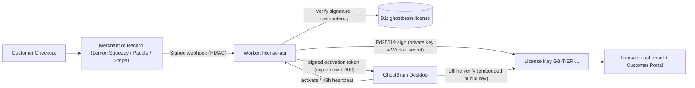
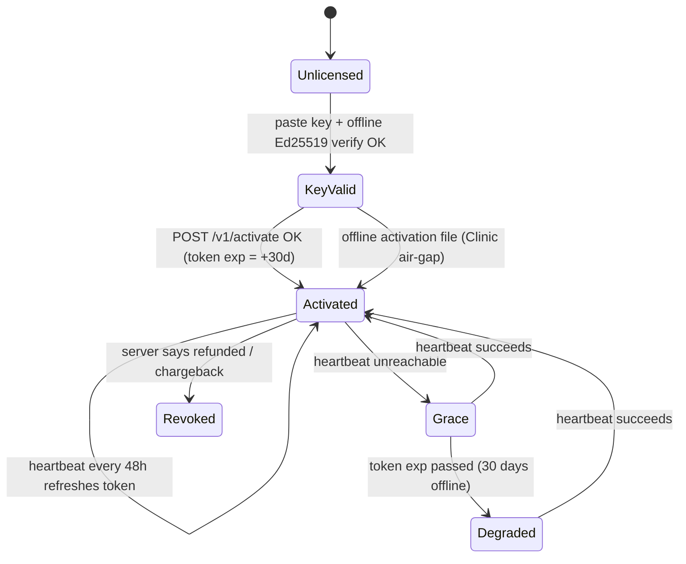
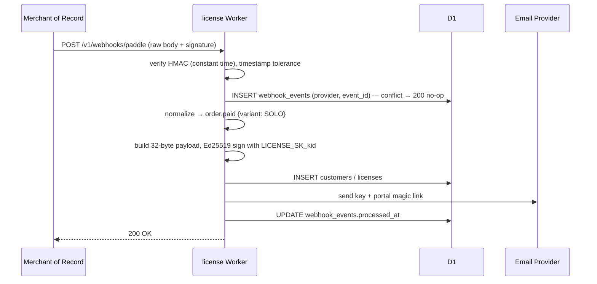

# 02 — Commercial Pricing & Licensing System

> **Project ID:** `P2-LICENSE` · **Status:** Spec locked, implementation after P1 Phase 2 · **Owner Lens:** Deep R&D
> **Depends on:** `P1` Worker infra (`workers/`), `P1` `LicenseGate` interface · **Consumed by:** `P1` feature gates, `P3` Clinic activation

---

## 0. Scope & Boundaries

| In Scope (P2) | Out of Scope |
| :--- | :--- |
| Tier definitions & feature entitlements | Relay transport (P1) |
| Merchant-of-Record (MoR) webhook ingestion | Clinic LAN auth / RBAC (P3) |
| Ed25519 license issuance, activation, heartbeat, revocation | EULA wording (05) |
| `packages/licensing-client` offline verifier | |
| Customer license portal (re-download keys, manage seats/devices) | |

---

## 1. Tier Matrix

| Tier | Key Prefix | Price | Billing Model | Entitlements |
| :--- | :--- | :--- | :--- | :--- |
| **Solo Desktop** | `GB-SOLO-` | **$49** one-time | Perpetual license + 12 months of updates | Local RAG engine, unlimited folders, power modes, up to 3 personal machines |
| **Cloud Relay Pro** (add-on) | `GB-PRO-` | **$6/mo** or **$59/yr** | Subscription (requires active Solo) | E2E WSS relay, web dashboard, offline clipper & deferred query queue, multi-device |
| **Clinic / Team Bundle** | `GB-CLINIC-` | **$499** one-time + **$49/mo** *or* **$29/seat/mo** | Perpetual server license + subscription for updates/support/seats | LAN Host mode, Air-Gap, SQLCipher, RBAC, audit log, offline activation |

**Perpetual-fallback rule (Solo & Clinic base):** a license works forever for every build whose `release_date ≤ updates_until`. After expiry, the app keeps working on the last eligible version; newer builds prompt for an update renewal (planned: ~$29/yr renewal — **open decision**).

> [!IMPORTANT]
> **Open pricing decision — Clinic subscription.** "$49/mo or $29/seat/mo" needs a single rule. **Recommendation:** `$49/mo includes 3 named seats; each additional seat $29/mo`. This gives a smooth price curve (3 seats = $49, 4 = $78, 10 = $252). Confirm before building the seat-sync webhook.

### 1.1 Feature Flags (embedded in license payload)

| Bit | Flag | SOLO | PRO | CLINIC |
| :-- | :--- | :-: | :-: | :-: |
| 0 | `core.local_rag` | ✅ | ✅ (via Solo) | ✅ |
| 1 | `relay.wss` | — | ✅ | — |
| 2 | `relay.deferred_queue` | — | ✅ | — |
| 3 | `lan.host` | — | — | ✅ |
| 4 | `lan.airgap` | — | — | ✅ |
| 5 | `security.sqlcipher` | — | — | ✅ |
| 6 | `security.rbac_audit` | — | — | ✅ |
| 7 | `support.priority` | — | — | ✅ |

---

## 2. Architecture



### 2.1 MoR Strategy

| Option | MoR? | Tax Handling | Notes |
| :--- | :-: | :--- | :--- |
| **Paddle** | ✅ | Global VAT/GST/sales tax remitted by Paddle | Strong B2B invoicing (good for clinics) |
| **Lemon Squeezy** | ✅ | Global tax remitted | Simple indie onboarding; Stripe-owned |
| **Stripe (direct)** | ❌ | Seller registers/remits tax (Stripe Tax assists) | Most control, most compliance burden |

**Recommendation:** Start with a true MoR (Paddle or Lemon Squeezy) to avoid per-country tax registration as a solo vendor. Implement a `PaymentProviderAdapter` so the Worker can switch providers without touching issuance logic.

```text
interface PaymentProviderAdapter {
  verifyWebhook(rawBody, headers, secret): boolean   // constant-time HMAC compare
  normalize(event): NormalizedEvent                   // order.paid | subscription.created | .renewed | .cancelled | .past_due | refund | chargeback
}
```

| Provider | Signature Header | Algorithm |
| :--- | :--- | :--- |
| Lemon Squeezy | `X-Signature` | HMAC-SHA256(raw body) |
| Paddle Billing | `Paddle-Signature` (`ts=…;h1=…`) | HMAC-SHA256(`ts:rawBody`) |
| Stripe | `Stripe-Signature` (`t=…,v1=…`) | HMAC-SHA256(`t.rawBody`), 5-min tolerance |

---

## 3. License Key Format

Keys are **self-contained and offline-verifiable**: `GB-<TIER>-<base32(payload ‖ signature)>` grouped in blocks of 5 for readability.

### 3.1 Binary Payload (v1, 32 bytes)

| Offset | Size | Field | Notes |
| :-- | :-- | :--- | :--- |
| 0 | 1 | `version` | `0x01` |
| 1 | 1 | `kid` | Signing-key ID (enables key rotation) |
| 2 | 1 | `tier` | 1=SOLO, 2=PRO, 3=CLINIC |
| 3 | 1 | `max_activations` | Machines (SOLO=3) |
| 4 | 8 | `license_id` | Random 64-bit |
| 12 | 4 | `issued_at` | Unix seconds |
| 16 | 4 | `updates_until` | Unix seconds (perpetual-fallback cutoff) |
| 20 | 2 | `seats` | CLINIC named seats |
| 22 | 2 | `feature_flags` | §1.1 bitfield |
| 24 | 8 | `email_hash` | First 8 bytes of BLAKE3(lowercase email) — ownership proof, not PII |

`signature = Ed25519.sign(sk[kid], "GBLIC1" ‖ payload)` → 64 bytes. Total 96 bytes → 154 base32 chars (Crockford, no padding).

### 3.2 Activation Token (online-issued, short-lived)

```json
{
  "typ": "gb-activation/1",
  "license_id": "9f2c…",
  "machine": "base64url(BLAKE3(machine_id ‖ per-install salt))",
  "tier": "PRO",
  "flags": 7,
  "status": "active",
  "iat": 1792300000,
  "exp": 1794892000
}
```
Signed as compact JWS with `alg: EdDSA`. `exp = iat + 30 days` → this **is** the offline grace period.

---

## 4. Activation, Heartbeat & Grace Logic



| Tier | Heartbeat Required? | When Grace Expires (Degraded) | When Revoked |
| :--- | :--- | :--- | :--- |
| **SOLO** | Optional (activation-count enforcement + revocation check only) | **Never degrades** — perpetual offline use is a promise | Local features disabled after next successful check |
| **PRO** | Yes (48h) | Relay + queue disabled; local engine unaffected | Relay disabled immediately |
| **CLINIC** | Air-gap: **No** (annual offline file). Connected: 48h | Non-blocking banner + admin email; **never** blocks read access to clinical data | Banner + update channel closed; data access preserved |

> [!CAUTION]
> **Patient-safety rule:** licensing failures must never lock clinicians out of their own records. Degraded Clinic mode = no updates + compliance banner, never data lockout.

> [!WARNING]
> **Conflict resolved:** the requested 48h heartbeat is incompatible with P3 Air-Gap (zero egress). Air-gapped Clinic installs use **challenge/response offline activation**: the app shows a request code (QR) → admin enters it on the portal from any internet device → downloads a signed `.gbactivation` file valid until subscription end + 30 days → imports via USB.

**Machine fingerprint:** `BLAKE3(OS machine-id ‖ install_salt)`; raw hardware identifiers never leave the device. Users can self-deactivate machines from the portal (max 3 swaps / 30 days).

---

## 5. D1 Schema — `ghostbrain-license`

```sql
CREATE TABLE customers (
  id            TEXT PRIMARY KEY,
  email         TEXT NOT NULL UNIQUE,
  email_hash8   BLOB NOT NULL,
  provider      TEXT NOT NULL CHECK (provider IN ('lemonsqueezy','paddle','stripe')),
  provider_cust TEXT NOT NULL,
  created_at    INTEGER NOT NULL,
  UNIQUE (provider, provider_cust)
);

CREATE TABLE licenses (
  id              TEXT PRIMARY KEY,           -- hex(license_id)
  customer_id     TEXT NOT NULL REFERENCES customers(id),
  tier            TEXT NOT NULL CHECK (tier IN ('SOLO','PRO','CLINIC')),
  kid             INTEGER NOT NULL,
  key_text        TEXT NOT NULL UNIQUE,       -- full GB-… key (re-download)
  seats           INTEGER NOT NULL DEFAULT 1,
  max_activations INTEGER NOT NULL,
  feature_flags   INTEGER NOT NULL,
  updates_until   INTEGER NOT NULL,
  status          TEXT NOT NULL DEFAULT 'active'
                  CHECK (status IN ('active','past_due','cancelled','refunded','revoked')),
  parent_license  TEXT REFERENCES licenses(id), -- PRO add-on → SOLO base
  provider_order  TEXT,
  provider_sub    TEXT,
  created_at      INTEGER NOT NULL,
  updated_at      INTEGER NOT NULL
);
CREATE INDEX idx_licenses_customer ON licenses(customer_id);
CREATE INDEX idx_licenses_sub      ON licenses(provider_sub);

CREATE TABLE activations (
  id            TEXT PRIMARY KEY,
  license_id    TEXT NOT NULL REFERENCES licenses(id) ON DELETE CASCADE,
  machine_hash  TEXT NOT NULL,
  label         TEXT,                         -- 'Kamal-Desktop'
  mode          TEXT NOT NULL CHECK (mode IN ('online','offline_file')),
  last_seen_at  INTEGER NOT NULL,
  deactivated_at INTEGER,
  created_at    INTEGER NOT NULL,
  UNIQUE (license_id, machine_hash)
);

CREATE TABLE subscriptions (
  provider_sub       TEXT PRIMARY KEY,
  license_id         TEXT NOT NULL REFERENCES licenses(id),
  plan               TEXT NOT NULL,           -- 'pro_monthly','pro_yearly','clinic_base','clinic_seat'
  quantity           INTEGER NOT NULL DEFAULT 1,
  status             TEXT NOT NULL,
  current_period_end INTEGER NOT NULL,
  updated_at         INTEGER NOT NULL
);

CREATE TABLE webhook_events (                 -- idempotency ledger
  provider     TEXT NOT NULL,
  event_id     TEXT NOT NULL,
  event_type   TEXT NOT NULL,
  received_at  INTEGER NOT NULL,
  processed_at INTEGER,
  error        TEXT,
  PRIMARY KEY (provider, event_id)
);

CREATE TABLE signing_keys (                   -- PUBLIC metadata only; private keys live in Worker secrets
  kid         INTEGER PRIMARY KEY,
  public_key  BLOB NOT NULL,
  active_from INTEGER NOT NULL,
  retired_at  INTEGER
);
```

---

## 6. Worker API Surface (`workers/license`)

| Method | Path | Auth | Purpose |
| :--- | :--- | :--- | :--- |
| `POST` | `/v1/webhooks/:provider` | Provider HMAC | Ingest MoR events → issue/update/revoke |
| `POST` | `/v1/activate` | License key | Bind machine, return activation token |
| `POST` | `/v1/heartbeat` | Activation token | Refresh token; return status/revocation |
| `POST` | `/v1/deactivate` | Activation token | Free a machine slot |
| `POST` | `/v1/offline/activate` | Portal session | Exchange request code → `.gbactivation` file |
| `GET`  | `/v1/portal/licenses` | Portal session (magic link) | List keys, activations, seats |
| `GET`  | `/v1/keys/public` | none | Published public keys by `kid` (also embedded in app) |

**Rate limits:** Workers Rate Limiting binding — `/activate` 10/min/IP, `/heartbeat` 4/hour/machine.

**Secrets (never committed):** `LICENSE_SK_<kid>` (Ed25519 private key, PKCS8), `LS_WEBHOOK_SECRET`, `PADDLE_WEBHOOK_SECRET`, `STRIPE_WEBHOOK_SECRET`, `EMAIL_API_KEY` — all via `wrangler secret put`.

---

## 7. Webhook → Issuance Sequence



Refund / chargeback → `licenses.status='refunded'|'revoked'` → next heartbeat returns revoked; key ID appended to the revocation list bundled in the next app release (covers offline Solo keys).

---

## 8. Chapter Checklists

### L-Ch1 — Signing Core & Offline Verifier
- [ ] Generate Ed25519 keypair offline (kid=1); store private key in password manager + `wrangler secret put`.
- [ ] `packages/licensing-client`: base32 decode, payload parse, Ed25519 verify (`@noble/curves`), multi-`kid` public key ring.
- [ ] Test vectors: valid, tampered byte, wrong `kid`, expired `updates_until`, revoked list.

### L-Ch2 — MoR Webhooks & Issuance Worker
- [ ] Products/variants created in chosen MoR (Solo, Pro monthly/yearly, Clinic base, Clinic seat).
- [ ] `PaymentProviderAdapter` + signature verification + idempotency ledger.
- [ ] Issuance, email delivery, portal magic-link login.
- [ ] D1 migrations via `wrangler d1 migrations apply --remote`.

### L-Ch3 — Activation, Heartbeat & Grace in Desktop
- [ ] `LicenseGate` implementation replacing P1 stub; feature-flag checks at IPC boundary.
- [ ] Activation token storage in `safeStorage`; 48h heartbeat scheduler with jitter.
- [ ] Grace/Degraded UX per §4 table (non-blocking banners).

### L-Ch4 — Clinic Offline Activation & Seat Sync
- [ ] Request-code (QR) generator; `.gbactivation` import + verify.
- [ ] Seat quantity sync from subscription webhooks → seat cap enforced by P3 user manager.

### L-Ch5 — Hardening
- [ ] Key rotation drill (kid=2) with dual-verify window.
- [ ] Abuse monitoring: activation churn alerts.
- [ ] Refund/chargeback end-to-end test in MoR sandbox.

---

## 9. Anti-Piracy Posture (deliberately proportionate)
- Offline keys can be shared; the activation cap + PRO server-side features carry enforcement.
- No kernel drivers, no invasive DRM, no telemetry beyond heartbeat `{license_id, machine_hash, app_version}`.
- Clinic tier value is support, compliance docs, and updates — not lock-in.
