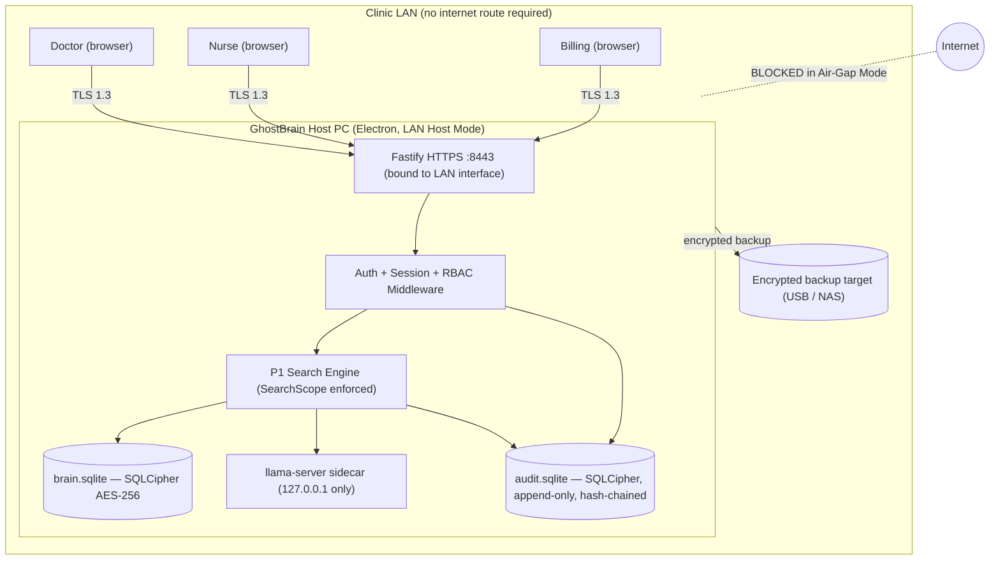
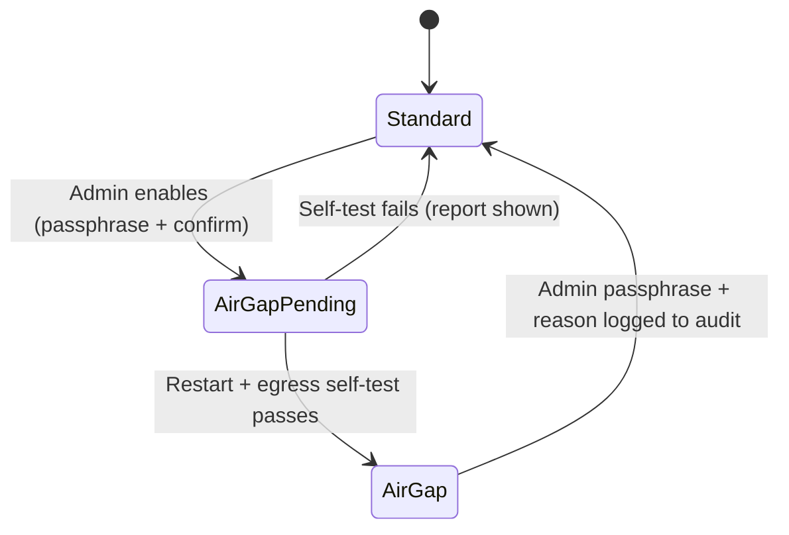
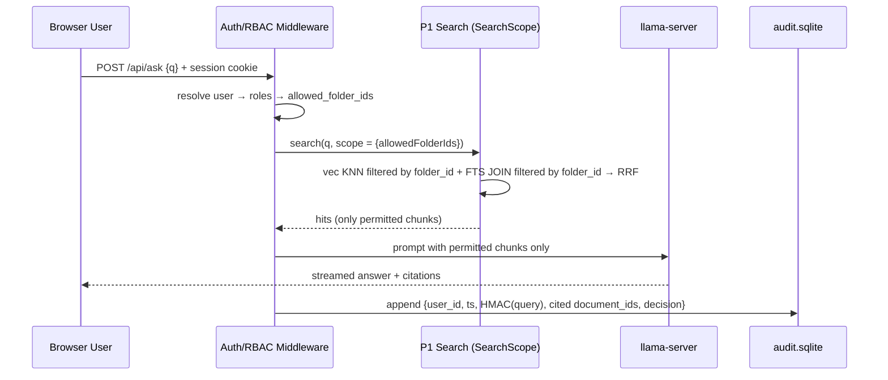

# 03 — Medical Clinic & Enterprise LAN Edition

> **Project ID:** `P3-CLINIC` · **Status:** Spec locked, implementation after P1 Phase 1 + P2 L-Ch4 · **Owner Lens:** Deep R&D
> **Depends on:** `P1` engine (`StorageDriver`, `SearchScope`, `ModelProvider`), `P2` `GB-CLINIC-*` offline activation
> **Consumed by:** `05` compliance documentation (BAA posture, HIPAA mapping)

> [!CAUTION]
> This document describes technical safeguards. It is **not legal advice** and does not by itself make any deployment HIPAA / DPDP / GDPR compliant. Compliance depends on the clinic's policies, risk analysis, and counsel review.

---

## 0. Scope & Boundaries

| In Scope (P3) | Out of Scope |
| :--- | :--- |
| Physical Air-Gap Mode (zero egress) | Cloud relay (disabled in this edition) |
| LAN Host Server (Fastify + TLS) for multi-seat browser access | Billing (P2) |
| Local user accounts, sessions, RBAC (folder permissions) | Model fine-tuning (P4) |
| SQLCipher at-rest encryption, key management, encrypted backups | |
| Append-only, tamper-evident `audit.sqlite` | |

---

## 1. Deployment Topology



---

## 2. Physical Air-Gap Mode

### 2.1 Mode Transition



### 2.2 Defense-in-Depth Egress Controls

| Layer | Control | Verification |
| :--- | :--- | :--- |
| **App config** | Relay client, `electron-updater`, crash reporter, heartbeat, any analytics **not constructed** (not just disabled) | Unit test: factory returns null implementations in Air-Gap |
| **Electron session** | `session.webRequest.onBeforeRequest` cancels any URL whose resolved host is not loopback / RFC1918 / link-local | E2E test asserts blocked requests |
| **Node networking** | Outbound guard wrapping `net`/`tls` connect; non-private destinations throw + audit event | Integration test |
| **LLM sidecar** | Use bundled `llama-server` bound to `127.0.0.1` (prefer over Ollama in this mode; no model pulls) | Port scan from LAN shows only `:8443` |
| **Models** | Pre-bundled GGUF + ONNX shipped in installer / offline bundle; BLAKE3 manifest verified at load | Hash mismatch → refuse to load |
| **Updates** | Signed offline update bundle (USB), Ed25519-verified with vendor key before install | Tampered bundle rejected |
| **OS (documented)** | Admin guide: Windows Firewall outbound-deny rule for app + sidecars | Checklist sign-off |

**Egress self-test:** on entering Air-Gap, the app attempts connections to a fixed list of public IPs/hosts; *all must fail at the app guard*. Result recorded in `audit.sqlite`.

---

## 3. LAN Host Server

| Concern | Decision |
| :--- | :--- |
| Framework | `Fastify` + `@fastify/helmet`, `@fastify/rate-limit`, `@fastify/cookie`, `@fastify/websocket` (token streaming) |
| Binding | Admin-selected LAN interface only (never `0.0.0.0` by default); port `8443` |
| TLS | On first run, generate a **local root CA** (ECDSA P-256, 10y) + server cert (SAN = host IP + `ghostbrain.local`, 397 days). Admin installs root CA on clinic devices via guided export. CA private key encrypted in keychain. |
| Discovery | mDNS `ghostbrain.local` (optional, LAN only) |
| Web UI | Same `apps/web` build served statically from the host; talks REST/WS to the host directly (no relay crypto — TLS covers LAN transport) |
| Headers | HSTS, `Content-Security-Policy: default-src 'self'`, `X-Frame-Options: DENY`, `Referrer-Policy: no-referrer` |

### 3.1 Authentication & Sessions
- Local accounts; passwords hashed with **argon2id** (m=64 MiB, t=3, p=1).
- Optional TOTP 2FA (offline-compatible) — required for `admin`.
- Session cookie: `HttpOnly; Secure; SameSite=Strict`, opaque 256-bit ID, server-side session table.
- **Automatic logoff:** 15 min idle (configurable 5–30), absolute 12 h.
- Lockout: 5 failed attempts → 15 min lock, audited.
- Break-glass emergency access account: sealed credentials, every use triggers a high-severity audit event.
- Seat cap enforced against `GB-CLINIC` license `seats` (named users, P2).

---

## 4. RBAC Model

| Role | Default Folder Access | Can Manage Users | Can View Audit | Can Change Mode |
| :--- | :--- | :-: | :-: | :-: |
| `admin` | Configurable (default: none — admins manage, they don't read PHI by default) | ✅ | ✅ | ✅ |
| `compliance_officer` | None | — | ✅ | — |
| `doctor` | Clinical folders | — | — | — |
| `nurse` | Clinical folders (subset) | — | — | — |
| `billing` | Billing / insurance folders only | — | — | — |

### 4.1 Query Enforcement Path



**Rules:**
- Scope is computed **server-side per request** from the session — never from client input.
- LLM context contains only permitted chunks → the model cannot leak unauthorized content.
- Conversation history is per-user; no shared history across users.
- Folder ACL changes take effect on the next request (no cache) and are audited.

---

## 5. Encryption at Rest (SQLCipher)

- Driver: `better-sqlite3-multiple-ciphers` (already the P1 `StorageDriver`), `PRAGMA cipher='sqlcipher'; PRAGMA legacy=4;` (SQLCipher 4 defaults: AES-256-CBC + HMAC-SHA512 page auth, PBKDF2-SHA512).
- Verify at implementation: `sqlite-vec` loads correctly against the multiple-ciphers build on all OSes (CI smoke test).
- **Key hierarchy:**
  - **DEK:** random 256-bit raw key per database (`PRAGMA key = "x'…'"` — raw key bypasses PBKDF2 cost on every open).
  - **KEK:** derived from admin recovery passphrase via argon2id; wraps the DEK (stored in `keystore.json`, AES-256-GCM).
  - **Unattended restart:** DEK additionally sealed with OS keychain (`safeStorage`) so the host can reboot without a human; policy toggle "require passphrase on boot" for higher-security sites.
- **Recovery kit:** printable recovery passphrase generated at setup; loss of both keychain and passphrase = unrecoverable data (explicitly warned).
- **Backups:** SQLite online backup API → encrypted copy (same cipher) to USB/NAS on schedule; monthly restore drill reminder; backups listed in audit log.
- Watched source folders remain on the OS file system → admin guide requires **BitLocker / FileVault** full-disk encryption on the host (checked and warned at setup).

---

## 6. Database Schemas

### 6.1 Additions to `brain.sqlite` (P3 migrations)

```sql
CREATE TABLE users (
  id            INTEGER PRIMARY KEY,
  username      TEXT NOT NULL UNIQUE COLLATE NOCASE,
  display_name  TEXT NOT NULL,
  password_hash TEXT NOT NULL,                -- argon2id encoded string
  totp_secret   BLOB,                         -- encrypted by DB cipher
  is_active     INTEGER NOT NULL DEFAULT 1 CHECK (is_active IN (0,1)),
  is_break_glass INTEGER NOT NULL DEFAULT 0 CHECK (is_break_glass IN (0,1)),
  failed_logins INTEGER NOT NULL DEFAULT 0,
  locked_until  INTEGER,
  created_at    INTEGER NOT NULL,
  updated_at    INTEGER NOT NULL
);

CREATE TABLE roles (
  id   INTEGER PRIMARY KEY,
  name TEXT NOT NULL UNIQUE                   -- admin, compliance_officer, doctor, nurse, billing
);

CREATE TABLE user_roles (
  user_id INTEGER NOT NULL REFERENCES users(id) ON DELETE CASCADE,
  role_id INTEGER NOT NULL REFERENCES roles(id) ON DELETE CASCADE,
  PRIMARY KEY (user_id, role_id)
) WITHOUT ROWID;

CREATE TABLE folder_acl (
  folder_id  INTEGER NOT NULL REFERENCES watched_folders(id) ON DELETE CASCADE,
  role_id    INTEGER NOT NULL REFERENCES roles(id) ON DELETE CASCADE,
  permission TEXT NOT NULL CHECK (permission IN ('read')),   -- extensible
  PRIMARY KEY (folder_id, role_id)
) WITHOUT ROWID;

CREATE TABLE sessions (
  id_hash       BLOB PRIMARY KEY,             -- SHA-256 of cookie value
  user_id       INTEGER NOT NULL REFERENCES users(id) ON DELETE CASCADE,
  created_at    INTEGER NOT NULL,
  last_active   INTEGER NOT NULL,
  expires_at    INTEGER NOT NULL,
  ip            TEXT,
  user_agent    TEXT
) WITHOUT ROWID;

-- conversations gain an owner for per-user isolation
ALTER TABLE conversations ADD COLUMN owner_user_id INTEGER REFERENCES users(id);

-- Resolve allowed folders for a user
CREATE VIEW v_user_folders AS
SELECT DISTINCT ur.user_id, fa.folder_id
FROM user_roles ur JOIN folder_acl fa ON fa.role_id = ur.role_id
WHERE fa.permission = 'read';
```

### 6.2 `audit.sqlite` (separate SQLCipher DB, separate DEK)

```sql
CREATE TABLE audit_log (
  seq            INTEGER PRIMARY KEY AUTOINCREMENT,  -- monotonic, gaps detectable
  ts_ms          INTEGER NOT NULL,
  actor_user_id  INTEGER,                            -- NULL for system events
  event_type     TEXT NOT NULL CHECK (event_type IN (
                   'login_ok','login_fail','logout','session_timeout','lockout',
                   'query','acl_change','user_change','mode_change','backup',
                   'restore','egress_blocked','break_glass','export','key_rotation')),
  query_hmac     BLOB,                               -- HMAC-SHA256(audit_key, normalized query)
  cited_doc_ids  TEXT,                               -- JSON int array of document_ids
  cited_doc_hashes TEXT,                             -- JSON array of BLAKE3 content hashes (hex, truncated 16)
  decision       TEXT CHECK (decision IN ('allow','deny','error')),
  client_ip      TEXT,
  detail_json    TEXT,                               -- MUST NOT contain PHI (validator enforced)
  prev_hash      BLOB NOT NULL,                      -- row_hash of seq-1 (genesis = 32 zero bytes)
  row_hash       BLOB NOT NULL                       -- BLAKE3(prev_hash ‖ canonical(row fields))
);
CREATE INDEX idx_audit_ts    ON audit_log(ts_ms);
CREATE INDEX idx_audit_actor ON audit_log(actor_user_id, ts_ms);

-- Append-only enforcement
CREATE TRIGGER audit_no_update BEFORE UPDATE ON audit_log
BEGIN SELECT RAISE(ABORT, 'audit_log is append-only'); END;

CREATE TRIGGER audit_no_delete BEFORE DELETE ON audit_log
BEGIN SELECT RAISE(ABORT, 'audit_log is append-only'); END;

CREATE TABLE audit_anchor (                          -- periodic checkpoints for external attestation
  seq        INTEGER PRIMARY KEY,
  row_hash   BLOB NOT NULL,
  created_at INTEGER NOT NULL
);
```

> [!WARNING]
> **Spec correction — filenames can be PHI.** The original requirement logs "cited filenames", but clinic files are routinely named after patients (e.g., `Sharma_R_MRI_2026.pdf`), which would put plaintext PHI in the log. **This spec logs `document_id` + truncated content hash instead.** Authorized compliance officers resolve IDs → filenames at report time inside the encrypted app.

> [!NOTE]
> **Why HMAC, not a plain hash, for queries:** clinical queries are low-entropy ("ramesh sharma hba1c") and a plain SHA-256 is brute-forceable. A keyed HMAC (key in keychain, separate from DB keys) supports equality matching for investigations without enabling dictionary attacks.

**Tamper evidence:** triggers stop casual edits; the hash chain detects offline edits to the file. A daily `audit_anchor` checkpoint is shown in the admin UI and can be printed/exported for an external record. Retention default: 6 years (common HIPAA documentation practice — confirm with counsel), no automatic purge.

---

## 7. HIPAA Security Rule — Technical Safeguards Mapping (45 CFR §164.312)

| Standard | GhostBrain Control |
| :--- | :--- |
| (a)(1) Access control — unique user ID | Local named accounts, no shared logins |
| (a)(2)(ii) Emergency access | Break-glass account, high-severity audit |
| (a)(2)(iii) Automatic logoff | 15-min idle timeout |
| (a)(2)(iv) Encryption/decryption | SQLCipher AES-256 + host full-disk encryption |
| (b) Audit controls | Append-only, hash-chained `audit.sqlite` |
| (c)(1) Integrity | SQLCipher HMAC page auth; BLAKE3 document hashes; audit hash chain |
| (d) Person/entity authentication | argon2id passwords, optional TOTP (required for admin) |
| (e)(1) Transmission security | TLS 1.3 on LAN; Air-Gap eliminates internet transmission |

Also relevant for international clinics: **India DPDP Act 2023**, **GDPR** (Art. 32 security of processing) — mapped in `05-LEGAL-AND-TESTING.md`.

---

## 8. Chapter Checklists

### C-Ch1 — Air-Gap Mode & Egress Guard
- [ ] Null-implementation factories for relay/updater/telemetry/heartbeat.
- [ ] Electron session filter + Node outbound guard + audit events.
- [ ] Egress self-test + report UI; offline signed update bundle import.

### C-Ch2 — LAN Host Server & TLS
- [ ] Fastify server in main process (or dedicated `utilityProcess`), interface picker.
- [ ] Local CA + server cert generation, rotation, root-CA export wizard.
- [ ] Static web UI hosting, WS token streaming, security headers, rate limits.

### C-Ch3 — Accounts, Sessions & RBAC
- [ ] Users/roles/ACL migrations; admin user-management UI.
- [ ] argon2id, TOTP, lockout, idle timeout, break-glass.
- [ ] `SearchScope` enforcement + per-user conversations; unauthorized-access test suite.

### C-Ch4 — SQLCipher & Key Management
- [ ] Encrypt-in-place migration for existing `brain.sqlite` (`sqlcipher_export` pattern), with pre-migration backup.
- [ ] DEK/KEK hierarchy, keychain sealing, recovery kit, boot policy.
- [ ] Scheduled encrypted backups + restore drill.

### C-Ch5 — Audit Logger & Compliance Reporting
- [ ] `audit.sqlite` with triggers, hash chain, anchors; PHI validator on `detail_json`.
- [ ] Chain verification tool in admin UI; CSV export for compliance officer (resolves IDs only for authorized role).
- [ ] Safeguards mapping document generated from §7 for clinic risk analysis.

### C-Ch6 — Validation
- [ ] Packet capture during 24h soak in Air-Gap → zero non-LAN packets from app processes.
- [ ] Pen-test checklist: session fixation, IDOR on conversations, ACL bypass via crafted queries, prompt injection attempting cross-folder leakage.
- [ ] Pilot with one friendly clinic under signed evaluation agreement (synthetic data first).
