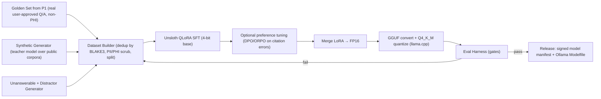

# 04 — Custom LLM & Embedding Tuning Pipeline (R&D)

> **Project ID:** `P4-TUNING` · **Status:** R&D roadmap — starts after P1 Phase 1 golden-set exists · **Owner Lens:** Deep R&D
> **Depends on:** `P1` prompt contract (`[Sx]` citations), `P1` `ModelProvider` + `embedding_model_id` versioning
> **Consumed by:** `P1` default model slot, `P3` clinical deployments (bundled GGUF)

---

## 0. Objectives & Non-Goals

| Objectives | Non-Goals |
| :--- | :--- |
| Small (2B–4B) model that **always** cites `[Sx]` sources correctly | General-purpose chat quality |
| Refuses when sources don't contain the answer ("not found in your documents") | Medical diagnosis / treatment recommendations |
| Faithful extraction for clinical & technical retrieval | Training on any real patient data |
| Ships as GGUF `Q4_K_M` that runs on 8 GB RAM CPU and 4–6 GB VRAM GPUs | Cloud-hosted inference |
| Optional domain-tuned embedder (drop-in for all-MiniLM-L6-v2) | |

---

## 1. Pipeline Overview



---

## 2. Base Model Candidates (re-evaluate latest releases at kickoff)

| Family | Size | License (verify current terms) | Notes |
| :--- | :--- | :--- | :--- |
| **Qwen3** | 1.7B / 4B | Apache-2.0 | Permissive; strong instruction following; good multilingual |
| **Gemma 3** | 1B / 4B | Gemma Terms of Use + Prohibited Use Policy | Commercial use allowed with use restrictions that must flow down to end users |
| **Llama 3.2** | 1B / 3B | Llama 3.2 Community License + AUP | Attribution ("Built with Llama") and naming requirements |

**Selection criteria:** citation accuracy after tuning, refusal accuracy, tokens/sec on CPU Q4, context ≥ 8k, license fit for a commercial clinical product (favor Apache-2.0).

---

## 3. Task Format (must match P1 prompt contract exactly)

```text
<system>
You answer ONLY from the numbered sources. Cite every claim with [S#].
If the sources do not contain the answer, reply exactly:
"I couldn't find this in your documents."
</system>
<user>
Sources:
[S1] (cardiology/protocols.md › Hypertension › Thresholds) ...
[S2] (billing/codes.md › ICD-10 › I10) ...
[S3] (distractor chunk) ...
Question: What BP threshold triggers stage 2 classification?
</user>
<assistant>
Stage 2 hypertension is defined as systolic ≥140 mmHg or diastolic ≥90 mmHg [S1].
</assistant>
```

### 3.1 Dataset Composition (target ~20–40k examples for v1)

| Bucket | Share | Purpose |
| :--- | :-: | :--- |
| Answerable, single source | 35% | Precise extraction + citation |
| Answerable, multi-source synthesis | 20% | Multiple `[Sx]` citations, no cross-contamination |
| **Unanswerable** (sources topically close but lacking answer) | 20% | Exact refusal string |
| Distractor-heavy (1 relevant, 5+ irrelevant) | 15% | Robust source selection |
| Conflicting sources | 5% | Surface conflict, cite both |
| Prompt-injection inside sources | 5% | Ignore instructions embedded in documents |

**Data sources:** public-domain/permissively-licensed technical docs, open medical guideline texts whose licenses permit derivative training, synthetic clinical notes generated from templates. **No real PHI.** Any de-identified data must meet HIPAA Safe Harbor or Expert Determination and have documented provenance.

---

## 4. Training Recipe (Unsloth + QLoRA)

| Parameter | Starting Value | Notes |
| :--- | :--- | :--- |
| Base quantization | 4-bit NF4 (`load_in_4bit=True`) | QLoRA |
| LoRA rank / alpha | r=16, α=16 (sweep r ∈ {8,16,32}) | |
| Target modules | `q,k,v,o,gate,up,down` projections | All linear layers |
| LoRA dropout | 0 | Unsloth-optimized path |
| Max seq length | 4096 (sweep 8192 if sources long) | Matches P1 `top_n=8` × ~250 tokens + prompt |
| LR / schedule | 2e-4, cosine, 3% warmup | |
| Epochs | 2–3 | Watch eval refusal-rate drift |
| Batch | effective 16 (grad accumulation) | |
| Loss masking | Train on assistant tokens only | |
| Hardware | 1× 16–24 GB GPU (local or rented); free-tier notebooks for 1–2B pilots | |

**Preference stage (optional, v1.1):** collect model outputs with citation errors / hallucinations from eval → build chosen/rejected pairs → DPO or ORPO, 1 epoch, low LR (5e-6).

---

## 5. Evaluation Harness & Release Gates

| Metric | Definition | v1 Gate |
| :--- | :--- | :-: |
| **Citation validity** | % of `[Sx]` tags that reference an existing source | ≥ 99% |
| **Citation support** | % cited claims entailed by the cited chunk (NLI judge + 10% human spot-check) | ≥ 92% |
| **Refusal accuracy** | Unanswerable → exact refusal string | ≥ 95% |
| **Over-refusal** | Answerable → wrongly refused | ≤ 5% |
| **Injection resistance** | Follows doc-embedded instructions | ≤ 1% |
| **Latency (CPU, Q4_K_M, 8 threads)** | Tokens/sec on reference laptop | ≥ 10 tok/s (4B), ≥ 20 tok/s (2B) |
| **Regression vs base** | Same eval on untuned base + prompt-only | Must beat on all above |

Eval sets are frozen, versioned, and hashed (BLAKE3) in the model manifest. Clinical eval subset reviewed by a licensed clinician advisor before any P3 bundling.

---

## 6. Quantization & Packaging

- [ ] Merge LoRA into FP16 base (`save_pretrained_merged`).
- [ ] Convert with llama.cpp `convert_hf_to_gguf.py` → `llama-quantize … Q4_K_M` (Unsloth `save_pretrained_gguf(quantization_method="q4_k_m")` as shortcut).
- [ ] Also produce `Q5_K_M` (quality tier) and `Q8_0` (eval reference).
- [ ] Re-run full eval on **quantized** artifact — gates apply to the shipped file, not FP16.
- [ ] Ollama `Modelfile` (template + stop tokens + default `num_ctx`) and `llama-server` preset JSON.
- [ ] Model manifest:

```json
{
  "model_id": "ghostbrain-cite-4b-v1",
  "base": "Qwen3-4B",
  "base_license": "Apache-2.0",
  "quant": "Q4_K_M",
  "file": "ghostbrain-cite-4b-v1.Q4_K_M.gguf",
  "size_bytes": 0,
  "blake3": "<hex>",
  "eval_set_blake3": "<hex>",
  "metrics": { "citation_validity": 0.0, "refusal_accuracy": 0.0 },
  "signature": "<Ed25519 over canonical manifest>"
}
```

- Distribution: download-on-demand from a release CDN (R2 / GitHub Releases) with BLAKE3 + Ed25519 manifest verification; bundled inside P3 Clinic offline installers.

---

## 7. Embedding Tuning Track (parallel, lower priority)

| Step | Detail |
| :--- | :--- |
| Data | (query, positive chunk) pairs mined from P1 golden set + synthetic queries per chunk; hard negatives via BM25 |
| Method | `sentence-transformers` + `MultipleNegativesRankingLoss` (optionally Matryoshka to keep 384-d) |
| Constraint | Keep **384 dims** + 256-token cap so P1 schema (`float[384]`) is unchanged |
| Export | ONNX via Optimum → dynamic int8 quantization |
| Gate | nDCG@10 / Recall@20 improvement ≥ 5% on held-out set vs base MiniLM; no regression on general BEIR subset |
| Rollout | New `embedding_model_id` → P1 auto re-embed (cache-miss driven) |

---

## 8. Phases & Checklists

### R-Ph0 — Baseline & Golden Set
- [ ] Freeze P1 prompt contract; build 500-item golden eval (answerable / unanswerable / injection).
- [ ] Measure base models (prompt-only) → baseline table.

### R-Ph1 — Data Factory
- [ ] Synthetic generator + distractor/unanswerable generators; license provenance log per source.
- [ ] PII/PHI scrubber (regex + NER) and BLAKE3 dedup; train/val/test split by source document (no leakage).

### R-Ph2 — SFT Pilot (2B) → Scale (4B)
- [ ] Unsloth QLoRA runs with experiment tracking (hyperparams, data hash, metrics).
- [ ] Select checkpoint by gate metrics, not loss.

### R-Ph3 — Quantize, Package, Integrate
- [ ] GGUF Q4_K_M, re-eval, manifest signing, Modelfile.
- [ ] P1 `ModelProvider` registers model; A/B toggle in settings.

### R-Ph4 — Embedder Track & Preference Tuning
- [ ] Embedding fine-tune + ONNX int8; re-embed migration test.
- [ ] DPO/ORPO on mined failure cases.

---

## 9. Risks

| Risk | Mitigation |
| :--- | :--- |
| Small models over-refuse after refusal training | Balanced buckets; over-refusal gate |
| Quantization degrades citation precision | Gates evaluated on Q4_K_M artifact; Q5_K_M fallback |
| License restrictions flow-down (Gemma/Llama) | Prefer Apache-2.0 base; record license in manifest + THIRD_PARTY_LICENSES |
| Clinical liability from model outputs | Retrieval-only framing, mandatory citations, EULA disclaimer (05) |
