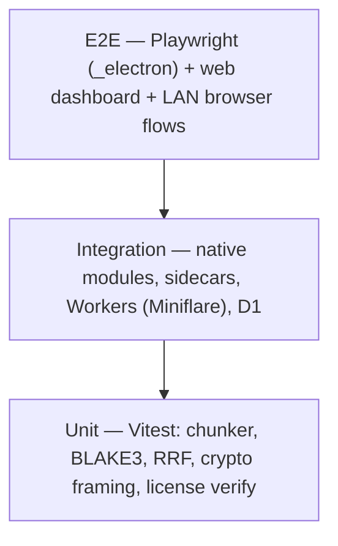

# 05 — Testing, Privacy & Legal Artifacts

> **Project ID:** `X-QA-LEGAL` (cross-cutting) · **Status:** Testing scaffold starts with P1 Ch 1.1; legal drafts before first paid release
> **Applies to:** `P1`, `P2`, `P3`, `P4`

> [!CAUTION]
> Legal sections below are **structured outlines for counsel**, not legal advice. Have a qualified lawyer (ideally covering India + US/EU distribution) review the EULA, Privacy Policy, and BAA posture before selling — especially to clinics.

---

## 1. Testing Pyramid



| Layer | Tooling | Runtime | Target Count / Coverage | Runs On |
| :--- | :--- | :--- | :--- | :--- |
| **Unit** | Vitest | Node (pure TS packages) | ≥ 85% lines in `packages/core`, `packages/crypto`, `packages/licensing-client` | Every push |
| **Integration** | Vitest + `ELECTRON_RUN_AS_NODE` for native ABI; `@cloudflare/vitest-pool-workers` for Workers/DO/D1 | Electron's Node ABI; workerd | All native + sidecar paths | Every PR, OS matrix |
| **E2E** | Playwright `_electron.launch()`; Playwright browser for web + LAN | Packaged app | Critical journeys (§1.3) | PR to `main`, nightly |
| **Security** | `npm audit`/OSV scanner, Electronegativity, secret scanning (gitleaks) | CI | Zero high/critical | Every PR |

### 1.1 Unit Test Catalogue (Vitest)
- **Chunker:** heading breadcrumbs; 256-token hard cap via real tokenizer; 32-token overlap; code fences never split under cap; deterministic output (snapshot); Unicode NFC normalization.
- **Hashing:** BLAKE3 official test vectors; streaming == one-shot; normalization makes whitespace-only edits hash-equal.
- **RRF:** hand-computed fusion fixtures; ties; one-list-empty cases; `k` sensitivity.
- **FTS sanitizer:** operators/quotes/`NEAR`/column filters neutralized; no FTS5 syntax errors on fuzzed input.
- **Crypto (`packages/crypto`):** RFC 7748 X25519 vectors, RFC 5869 HKDF vectors, AES-GCM tag tamper → reject, counter replay → reject, cross-runtime (Node ↔ workerd ↔ browser) round-trip vectors.
- **Licensing:** valid key, single-bit tamper, unknown `kid`, `updates_until` boundary, revocation list hit, grace-state transitions with fake clock.
- **Audit (P3):** chain computation, PHI validator rejects names/MRN patterns in `detail_json`.

### 1.2 Integration Test Catalogue
- `better-sqlite3-multiple-ciphers` + `sqlite-vec` load on Win/macOS/Linux under Electron ABI; vec0 KNN returns expected IDs; FTS5 triggers keep index consistent after insert/update/delete.
- SQLCipher: open with wrong key fails; encrypt-in-place migration preserves row counts + vec results.
- **Sidecar OOM recovery:** start `llama-server` with an oversized `num_ctx` / kill `-9` mid-stream → supervisor detects, restarts with reduced context, in-flight request returns a typed error, next request succeeds.
- Embedder crash mid-batch → `index_jobs` resumes, no duplicate `vec_chunks` rows.
- Watcher: 1,000 rapid writes → single reindex per file (debounce), rename detection without re-embed.
- Workers (Miniflare/workerd): device-code flow, JWT expiry, DO routing, hibernation wake, D1 queue TTL purge, webhook HMAC verification + idempotency.
- Air-Gap: outbound guard blocks public IPs; LAN server only listens on chosen interface.

### 1.3 E2E Journeys (Playwright)
1. First run → add folder → index completes → ask question → cited answer → click citation opens file.
2. Toggle Low-Power → model reloads CPU-only → answer still streams.
3. Pair desktop with web (device code) → ask from browser → streamed answer via relay.
4. Desktop offline → clip from web → desktop starts → clip ingested.
5. License: paste key → features unlock; simulate 31 days offline (fake clock) → PRO features degrade, local unaffected.
6. Clinic: enable Air-Gap → LAN login as nurse → billing folder content never appears in results or citations.

### 1.4 CI Matrix (GitHub Actions — illustrative)

```yaml
strategy:
  fail-fast: false
  matrix:
    include:
      - { os: windows-latest, target: nsis }
      - { os: macos-latest,   target: dmg, arch: arm64 }
      - { os: macos-13,       target: dmg, arch: x64 }   # verify runner availability at setup
      - { os: ubuntu-latest,  target: AppImage }          # E2E via xvfb-run
```
Pipeline stages: `lint+typecheck → unit → integration (matrix) → package (matrix) → sign/notarize (tags only) → E2E on packaged app → release draft`.

---

## 2. Privacy — Zero-Knowledge Privacy Policy (outline)

| Section | Required Content |
| :--- | :--- |
| Who we are | Legal entity, contact, grievance officer (DPDP) / DPO if applicable (GDPR) |
| Core promise | Documents, embeddings, queries, and answers are processed **on your device**; the relay transports only end-to-end-encrypted ciphertext we cannot decrypt |
| Data we do process | Account email + OAuth subject, device public keys & names, license/activation records (`license_id`, hashed machine ID, app version), encrypted queue blobs (TTL 30 days), payment data held by the MoR (not us) |
| Data we never collect | File contents, file names, queries, answers, embeddings, telemetry/analytics (default off; Air-Gap: impossible) |
| Legal bases | Contract performance (license, relay); legitimate interest (fraud prevention) |
| Sub-processors | Cloudflare (relay/D1/Pages), MoR (Paddle / Lemon Squeezy / Stripe), email provider |
| Retention | Account until deletion; activation logs 24 months; queue blobs ≤ 30 days |
| International transfers | Cloudflare global network; SCCs where applicable |
| User rights | Access, correction, erasure, portability, grievance redressal (DPDP), complaint to supervisory authority (GDPR) |
| Demo Brain | Visitor queries to the public demo are processed by the developer's demo node; rate-limited; not stored beyond abuse logs (state retention) |
| Children | Not directed to children |
| Changes & contact | Versioned policy, effective date |

---

## 3. Commercial EULA (outline)

1. **Grant:** non-exclusive, non-transferable license per tier (Solo: up to 3 personal machines; Clinic: one host + named seats).
2. **Perpetual fallback:** right to use versions released within the update period indefinitely.
3. **Subscriptions:** Relay Pro / Clinic subscriptions; effect of non-payment (feature degradation, never data deletion).
4. **Restrictions:** no reverse engineering of license checks, no resale of keys, no use to provide a competing hosted service.
5. **Your data:** you own all content; we have no access; you are responsible for backups and for lawful processing of any data you index.
6. **AI output disclaimer (prominent, capitalized):**
   > GHOSTBRAIN USES AI LANGUAGE MODELS THAT CAN PRODUCE INACCURATE, INCOMPLETE, OR FABRICATED OUTPUT ("HALLUCINATIONS"), EVEN WHEN CITATIONS ARE SHOWN. OUTPUT IS NOT MEDICAL, LEGAL, FINANCIAL, OR OTHER PROFESSIONAL ADVICE AND MUST NOT BE THE SOLE BASIS FOR CLINICAL DIAGNOSIS, TREATMENT, OR ANY DECISION AFFECTING HEALTH, SAFETY, OR LEGAL RIGHTS. A QUALIFIED PROFESSIONAL MUST VERIFY ALL OUTPUT AGAINST THE SOURCE DOCUMENTS.
7. **Not a medical device:** intended as a document search/retrieval aid; not intended to diagnose, treat, cure, or prevent disease (avoid SaMD claims in all marketing copy).
8. **Warranty disclaimer:** "as is", no fitness-for-purpose warranty to the extent permitted by law.
9. **Limitation of liability:** cap = fees paid in the 12 months preceding the claim; exclusion of indirect/consequential damages; carve-outs required by local law.
10. **Third-party models & components:** governed by their licenses (see `THIRD_PARTY_LICENSES.md`), including model use policies flowed down (e.g., Gemma/Llama AUPs if used).
11. **Export control, termination, governing law & venue** (decide jurisdiction with counsel), refund policy aligned with MoR terms.

---

## 4. BAA / On-Premise Software Vendor Posture

| Deployment | Vendor Access to PHI? | Posture |
| :--- | :--- | :--- |
| **Clinic Air-Gap / LAN** | No — software runs entirely on clinic hardware; vendor has no access | Generally positioned as an on-premise software vendor, **not** a Business Associate. Provide a written "No-PHI-Access Attestation" + security whitepaper (doc 03 §7) |
| **Remote support session** | Possible exposure on screen | Support only via clinic-controlled screen share with PHI views closed; or sign a BAA for that engagement |
| **Cloud Relay with PHI** | Ciphertext only, but HHS guidance treats cloud providers storing encrypted ePHI as BAs even without the key | **Relay Pro is not offered for PHI workloads.** Clinic edition disables relay; EULA prohibits PHI over relay unless a BAA is executed |

Prepare a **BAA template** (counsel-drafted) for cases where support access is unavoidable. Confirm posture with healthcare counsel per target market (US HIPAA, India DPDP + clinical establishment rules, EU GDPR special-category data).

---

## 5. `THIRD_PARTY_LICENSES.md` (generation plan)

- Generate in CI with `license-checker-rseidelsohn` (npm) + `pip-licenses` (markitdown sidecar) + manual entries for binaries and models.
- **Known components to list (verify versions/licenses at build):**

| Component | License (verify) | Obligation |
| :--- | :--- | :--- |
| Electron / Chromium | MIT + Chromium licenses (incl. LGPL components like FFmpeg) | Ship `LICENSES.chromium.html` (Electron includes it) |
| better-sqlite3-multiple-ciphers | MIT | Notice |
| SQLite | Public Domain | — |
| SQLite3MultipleCiphers / SQLCipher-compatible code | MIT / BSD-style | Notice |
| sqlite-vec | MIT / Apache-2.0 dual | Notice |
| BLAKE3 | CC0 / Apache-2.0 | — |
| onnxruntime-node | MIT | Notice |
| all-MiniLM-L6-v2 | Apache-2.0 | Notice |
| markitdown + its Python deps | MIT (+ deps vary) | Notices for all bundled deps |
| llama.cpp / llama-server | MIT | Notice |
| Ollama (if bundled/referenced) | MIT | Notice |
| @noble/curves, @noble/hashes | MIT | Notice |
| Fastify + plugins | MIT | Notice |
| Base LLM weights (P4) | Apache-2.0 / Gemma ToU / Llama Community | Attribution + AUP flow-down |
| Fonts / icons | Per asset | Per asset |

CI gate: fail build on any **GPL/AGPL** dependency in the shipped bundle unless explicitly approved.

---

## 6. `SECURITY.md` (outline)
- Supported versions table (latest minor + previous minor).
- Private reporting channel (GitHub Security Advisories / security@ email + PGP key); no public issues for vulns.
- Response SLAs: acknowledge 72 h, triage 7 days, fix critical ≤ 30 days.
- Scope: desktop app, LAN server, Workers, crypto protocol, license system. Out of scope: social engineering, DoS on free-tier limits.
- Safe-harbor statement for good-faith research; credit policy.
- Security architecture summary: E2E relay, SQLCipher, Air-Gap, signed updates, signed model manifests.

---

## 7. Code Signing & Notarization Checklist

### 7.1 Windows
- [ ] Choose certificate path: **OV** code-signing cert (keys must be on HSM/hardware token per CA/B Forum rules since 2023) **or** a cloud signing service (e.g., Azure Trusted/Artifact Signing — check eligibility for your country/entity type) **or** EV.
- [ ] Note: EV no longer guarantees instant SmartScreen reputation; reputation builds with download volume regardless — plan for early "unrecognized app" prompts.
- [ ] Cloud HSM / signing service usable from GitHub Actions (hardware USB tokens do not work on hosted runners).
- [ ] Sign app `.exe`, NSIS installer, **and** all sidecars (`llama-server.exe`, markitdown binary, native `.node`/`.dll`) with RFC 3161 timestamping.
- [ ] Verify: `signtool verify /pa /v` in CI.

### 7.2 macOS
- [ ] Apple Developer Program enrollment (individual or organization — org needs D-U-N-S).
- [ ] "Developer ID Application" certificate exported as `.p12` → GitHub Secret (base64) + password secret.
- [ ] Hardened runtime enabled; entitlements reviewed (Electron typically needs `com.apple.security.cs.allow-jit`; add others only if required).
- [ ] Sign nested binaries (sidecars, `.node`, `.dylib`) before the app bundle.
- [ ] Notarize with `notarytool` (App Store Connect API key in secrets) → `stapler staple` the `.dmg`.
- [ ] Verify: `spctl -a -vvv`, `codesign --verify --deep --strict`.

### 7.3 Linux
- [ ] AppImage signed with GPG detached signature; publish public key + SHA256SUMS.

### 7.4 Update Channel Integrity
- [ ] `electron-updater` validates publisher signature (Windows) / code signature (macOS).
- [ ] Offline update bundles (Clinic) signed with vendor Ed25519 key, verified before install.

---

## 8. Chapter Checklists

### Q-Ch1 — Test Scaffold (runs alongside P1 Ch 1.1)
- [ ] Vitest workspace config; first unit tests for IPC type map + renderer-has-no-Node assertion.
- [ ] GitHub Actions: lint, typecheck, unit on 3-OS matrix; gitleaks secret scan.

### Q-Ch2 — Native & Sidecar Integration Suite (with P1 Ch 1.2–1.3)
- [ ] Extension-load smoke tests per OS; OOM-recovery harness; watcher stress test.

### Q-Ch3 — E2E Suite (with P1 Phase 2)
- [ ] Playwright Electron journeys 1–5; Workers integration tests.

### Q-Ch4 — Legal Pack (before first paid sale)
- [ ] Privacy Policy, EULA, refund policy drafted from outlines → counsel review → published on Pages site + in-app.
- [ ] `THIRD_PARTY_LICENSES.md` generated in CI; `SECURITY.md` published.

### Q-Ch5 — Signing & Release (P1 Phase 3)
- [ ] Certificates procured; notarization green; signed release on all OSes; auto-update verified end-to-end.

### Q-Ch6 — Clinic Compliance Pack (before P3 pilot)
- [ ] No-PHI-Access attestation, security whitepaper, HIPAA/DPDP/GDPR mapping, BAA template (counsel).
- [ ] Journey 6 + Air-Gap packet-capture evidence archived per release.
